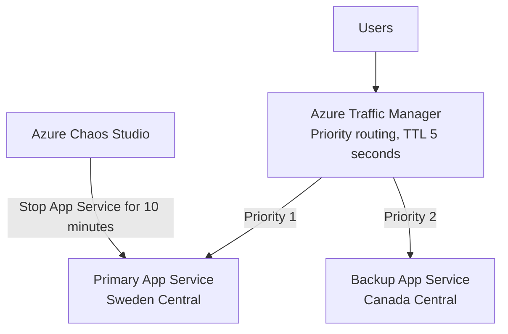

# Lab 04 — Cross-Region Resiliency with Azure Traffic Manager and Chaos Studio

## Objective

Build and validate a cross-region failover design for an Azure App Service workload by combining priority-based Azure Traffic Manager routing with controlled fault injection from Azure Chaos Studio.

## Scenario

A retail web application requires higher availability. The primary application runs in Sweden Central and the standby application runs in Canada Central. Traffic Manager directs users to the primary endpoint while it is healthy and fails over to the standby endpoint during an outage.

## Skills Demonstrated

- Azure App Service deployment across two regions
- Azure Traffic Manager priority routing
- Health probes, DNS TTL, failover, and failback behavior
- Azure Chaos Studio service-direct targets
- System-assigned managed identity and least-privilege RBAC
- Azure CLI automation and validation
- Troubleshooting subscription quotas, regional restrictions, runtime changes, SKU requirements, and DNS caching
- Cost cleanup after validation

## Architecture

## Resources Created

| Resource | Purpose |
|---|---|
| Two Linux App Service plans | Host the primary and standby applications |
| Two Azure Web Apps | Expose distinguishable primary and backup endpoints |
| Traffic Manager profile | Provide DNS-based priority routing and health monitoring |
| Chaos Studio target | Allow controlled fault injection against the primary app |
| Chaos experiment | Stop the primary App Service for 10 minutes |
| System-assigned managed identity | Execute the chaos action using automatically scoped Website Contributor permissions |

## Deployment Summary

The deployment used two regional App Service instances:

- Primary: Sweden Central
- Standby: Canada Central

Traffic Manager was configured with:

- Routing method: `Priority`
- Primary endpoint priority: `1`
- Backup endpoint priority: `2`
- DNS TTL: `5` seconds
- Probe protocol: `HTTPS`
- Probe port: `443`
- Probe path: `/health`

The App Service plans were temporarily upgraded to Standard S1 because full App Service integration with Traffic Manager required a supported tier.

## Validation

The full resiliency cycle was verified:

1. Traffic Manager initially returned the Sweden Central primary application.
2. DNS resolution pointed to the Sweden Central App Service.
3. Azure Chaos Studio stopped the primary App Service.
4. Traffic Manager failed over to the Canada Central backup application.
5. DNS resolution changed to the Canada Central App Service.
6. The primary App Service restarted after the experiment.
7. Both endpoints returned to `Online`.
8. Traffic Manager automatically failed back to Sweden Central.

See [validation-results.md](./validation-results.md) for sanitized terminal evidence.

## Real-World Troubleshooting

### Regional quota restrictions

Several regions returned a `Total VMs: 0` quota error for App Service plan creation. The deployment was adapted to use Sweden Central and Canada Central, where the subscription allowed provisioning.

### Region not accepting new customers

West Europe rejected resource creation with `RequestDisallowedByAzure`. The design was preserved by selecting alternate supported regions.

### Azure CLI runtime discovery change

The initial runtime lookup returned an empty value because the CLI output format had changed. A supported Node.js runtime was supplied explicitly.

### Traffic Manager integration and App Service tier

Free-tier App Service plans allowed the apps to run but did not provide the required full Traffic Manager integration. Both plans were temporarily upgraded to Standard S1, then the Traffic Manager endpoints were recreated so the Traffic Manager hostname registered correctly.

### Health-probe and DNS timing

Failover and failback were not instantaneous. Traffic Manager health probes, endpoint state transitions, and resolver caching introduced short delays. Validation therefore checked application state, endpoint monitor status, HTTP response identity, and DNS resolution separately.

## Security Notes

- No subscription IDs, tenant IDs, email addresses, secrets, tokens, or connection strings are stored in this repository.
- The Chaos experiment used a system-assigned managed identity.
- The generated permission scope was limited to the target web application using the Website Contributor role.
- Evidence is text-based and sanitized; portal screenshots are intentionally not required.

## Reproduction

Review and run the scripts in this directory in order:

1. [`scripts/deploy-apps.sh`](./scripts/deploy-apps.sh)
2. [`scripts/configure-traffic-manager.sh`](./scripts/configure-traffic-manager.sh)
3. Configure and run the Chaos Studio experiment as documented in [`scripts/chaos-studio-notes.md`](./scripts/chaos-studio-notes.md)
4. [`scripts/validate-failover.sh`](./scripts/validate-failover.sh)
5. [`scripts/cleanup.sh`](./scripts/cleanup.sh)

Replace all placeholder values before execution.

## Cleanup

All paid and temporary resources were deleted after validation to prevent ongoing Azure charges.

## Lessons Learned

- Resiliency testing requires validating both failure and recovery paths.
- DNS-based failover must be evaluated together with health probes and client-side caching.
- Azure subscription quotas and regional availability can materially affect deployment design.
- Controlled chaos testing can reveal whether a high-availability design actually behaves as expected.
