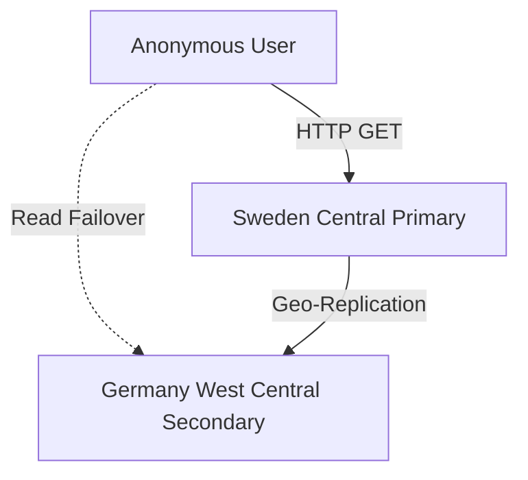

# Lab — Azure Blob Storage Public Website Resiliency

## Overview

This lab demonstrates how to provision and configure an Azure Blob Storage account to host public static assets with high availability, regional resiliency, and data protection settings. The configuration includes Read-Access Geo-Redundant Storage (RA-GRS) to survive regional outages, as well as Blob Soft Delete and Versioning to safeguard against accidental deletions and overwrites.

---

## Architecture

This lab uses a multi-layered resiliency design:
- **Redundancy**: RA-GRS replicates public website assets from the primary region (**Sweden Central**) to the paired region (**Germany West Central**).
- **Access Control**: Account-level public access is enabled, but restricted to a dedicated container (`public`) configured for anonymous **Blob read access only**.
- **Data Protection**: Blob and Container Soft Delete are configured along with Blob Versioning.

For a detailed design overview, see [architecture.md](./architecture/architecture.md).

---

## Azure Resources Table

| Resource Name | Type | Region | Configuration | Purpose |
|---|---|---|---|---|
| `rg-publicwebsite-lab` | Resource Group | Sweden Central | - | Scope for lab deployment |
| `stpublicwebsitelab` | Storage Account | Sweden Central | Standard GPv2, RA-GRS | High-availability object storage |
| `public` | Container | Sweden Central | Anonymous Blob Access Level | Hosts public website text files |

---

## Implementation Summary

1. **Resource Group & Storage Provisioning**: Created the resource group `rg-publicwebsite-lab` in Sweden Central. Provisioned a Standard StorageV2 account with RA-GRS redundancy.
2. **Anonymous Access Configuration**: Enabled anonymous access on the storage account and created a container named `public` with the access level restricted to **Blob only**.
3. **Data Protection Configuration**: Enabled soft delete for blobs (21 days), soft delete for containers (21 days), and blob versioning.
4. **Resiliency Validation**:
   - Uploaded `test-v1.txt` and verified direct anonymous access via its public URL.
   - Performed a soft-delete test by deleting the blob and restoring it.
   - Tested version history by overwriting the blob with `test-v2.txt` and later recovering the original version.

For detailed command-line scripts and step-by-step instructions, see [implementation-steps.md](./docs/implementation-steps.md).

---

## Validation Evidence

The resiliency configurations were validated through functional tests:

- **Anonymous HTTP Access Check**: Unauthenticated request returned HTTP 200 OK along with the content.
- **Soft Delete and Restoration Test**: Verified that a deleted blob returned HTTP 404, but was successfully recovered via CLI commands.
- **Versioning Rollback Test**: Uploaded a second version, verified the new content was live, and then successfully rolled back to version 1.

For sanitized terminal output and verification evidence, see [validation.md](./docs/validation.md).

### Planned Screenshot Placeholders
- [01-storage-account-created.png](./screenshots/01-storage-account-created.png)
- [02-ra-grs-enabled.png](./screenshots/02-ra-grs-enabled.png)
- [03-anonymous-access-enabled.png](./screenshots/03-anonymous-access-enabled.png)
- [04-public-container.png](./screenshots/04-public-container.png)
- [05-public-blob-url.png](./screenshots/05-public-blob-url.png)
- [06-data-protection-settings.png](./screenshots/06-data-protection-settings.png)
- [07-soft-delete-recovery.png](./screenshots/07-soft-delete-recovery.png)
- [08-version-history.png](./screenshots/08-version-history.png)
- [09-version-restored.png](./screenshots/09-version-restored.png)

---

## Security Considerations

> [!IMPORTANT]
> Anonymous access introduces public exposure risks. Apply least-privilege configurations to mitigate threat vectors.

- **Scoped Public Access**: Account-level anonymous access was enabled only to support the dedicated public container. The container access level was set to **Blob (anonymous read access for blobs only)**. This prevents users from listing container contents, making it harder for unauthorized actors to discover file names.
- **Sensitive Data Protection**: Anonymous containers must never be used for sensitive, personal, or corporate data. Only static, public-facing assets (like public web pages, CSS, or images) should reside here.
- **Edge Security**: For production, direct storage endpoints should be hidden behind **Azure Front Door** or **Azure CDN**. Front Door provides custom domain binding, HTTPS enforcement, Web Application Firewall (WAF) integration, and Web-tier DDoS protection.

---

## Key Learnings

- **RA-GRS Outage Protection**: Read-Access Geo-Redundant Storage ensures that if the primary region (Sweden Central) experiences a catastrophic outage, read traffic can fail over to the secondary paired region (Germany West Central).
- **Accidental Deletion Protection**: Soft delete prevents permanent data loss from accidental deletion by marking the resource as "soft-deleted" and preserving it for a retention period (21 days).
- **Accidental Modification Protection**: Versioning tracks each change. If a file is mistakenly modified or overwritten, it can be easily restored to a previous version from the history log.

---

## Cleanup

To delete all resources created during this lab and stop further billing, refer to the [cleanup.md](./docs/cleanup.md) guide.
