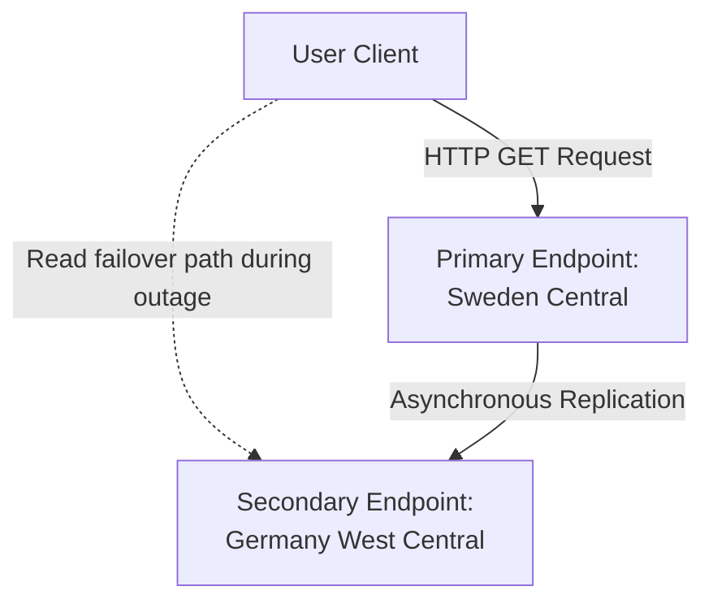
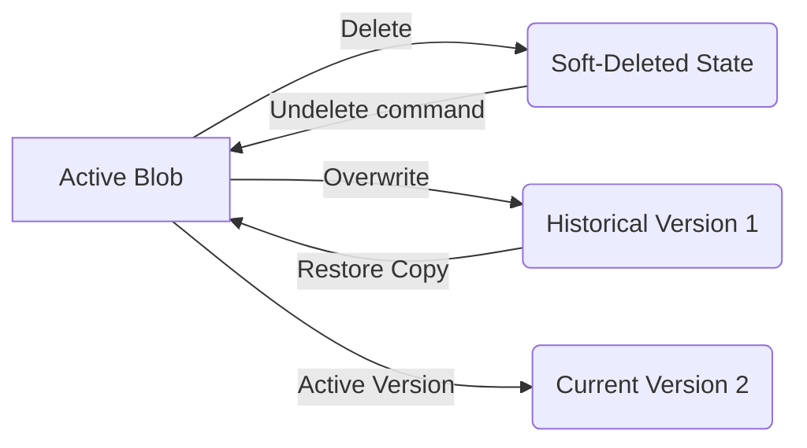

# Architecture Design

This document details the resiliency topology, access control design, and recovery architecture for the Azure Blob Storage public website hosting environment.

---

## 1. High Availability and Redundancy Flow

The storage account uses **Read-access geo-redundant storage (RA-GRS)** to provide geographical redundancy.

- **Primary Replica**: Data is synchronously written three times within Sweden Central (LRS).
- **Secondary Replica**: Data is replicated asynchronously to the paired region (Germany West Central), where it is also written three times.
- **Read-Access**: In the event of a regional outage affecting Sweden Central, the secondary endpoint `stpublicwebsitelab-secondary.blob.core.windows.net` remains readable to minimize downtime.

---

## 2. Recovery Architecture

To guard against data corruption, user error, or accidental deletions, three distinct layers of protection are configured:

1. **Blob Soft Delete (21 Days)**: Deleted blobs are kept in a soft-deleted state, allowing recovery before they are permanently purged.
2. **Container Soft Delete (21 Days)**: Protects the container itself from accidental deletion.
3. **Blob Versioning**: Track updates over time. Overwriting a blob automatically creates a historical version, allowing rollback of unwanted changes.

---

## 3. Production Architecture Best Practices

While this lab exposes storage directly, a production configuration should include:

- **Azure Front Door / Azure CDN**: To cache assets at Edge nodes, minimize latency, and handle custom SSL/TLS certificates.
- **Private Endpoint**: Restricting backend access to the storage account so only Front Door can access the container.
- **WAF (Web Application Firewall)**: Providing DDoS protection and vulnerability filtering.
- **IP Restrictions / Shared Access Signatures (SAS)**: For restricted assets.
